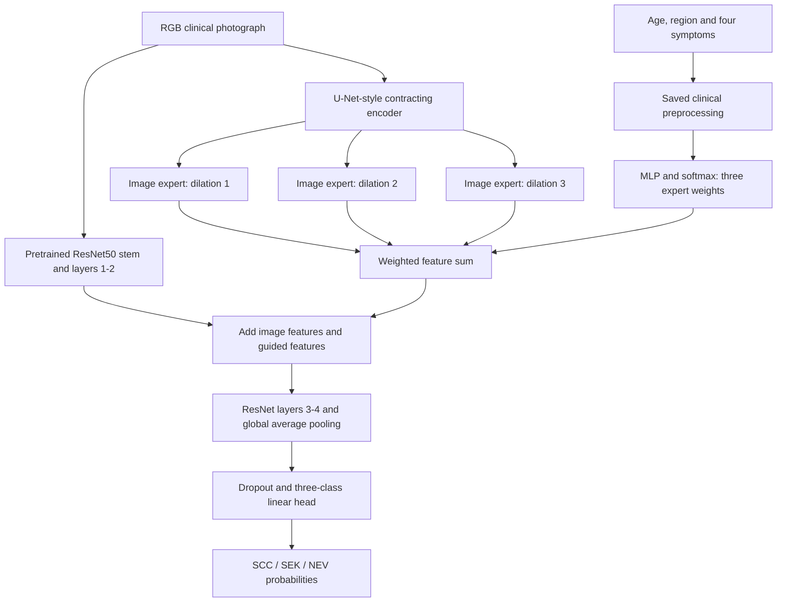
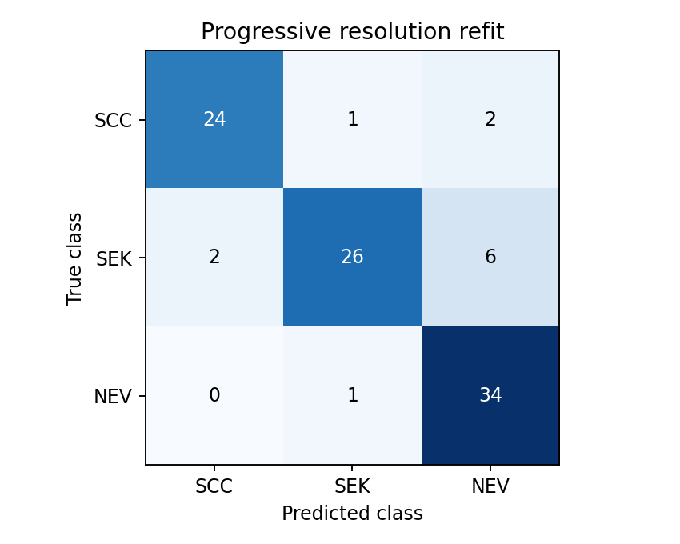

# DermaSense

### Clinically guided skin lesion classification with U-Net features and ResNet50

DermaSense is a PyTorch term project that combines a clinical photograph with structured patient information to classify **squamous cell carcinoma (SCC)**, **seborrheic keratosis (SEK)** or **nevus (NEV)**. A compact U-Net-style encoder extracts image features, a clinical network weights three image-processing experts, and a pretrained ResNet50 produces the class prediction.

The project covers selective dataset download, integrity checks, patient-grouped splitting, clinical preprocessing, GPU training, validation-based model selection, inference and quantitative evaluation.

**Measured test accuracy improved from 79.17% to 87.50% (84/96 images).** A separate model-selection experiment reached **93.75% validation accuracy**. The requested test target above 90% was not achieved. These numbers refer to different partitions and must not be interchanged.

> Research prototype for three selected lesion categories. The same test partition was evaluated during successive development iterations; results are exploratory and require independent external confirmation. This is not a clinically validated diagnostic system.

## Contents

- [Dataset and clinical inputs](#dataset-and-clinical-inputs)
- [Architecture](#architecture)
- [Training and model selection](#training-and-model-selection)
- [Results and interpretation](#results-and-interpretation)
- [Installation and reproduction](#installation-and-reproduction)
- [Inference](#inference)
- [Repository guide](#repository-guide)
- [Limitations and next experiments](#limitations-and-next-experiments)
- [References](#references)

## Dataset and clinical inputs

### PAD-UFES-20 subset

The [official PAD-UFES-20 release](https://data.mendeley.com/datasets/zr7vgbcyr2/1) contains smartphone clinical photographs and associated metadata. These are clinical photographs, not dermoscopy images. DermaSense retains only the following three labels:

| Label | Class | Images |
|---|---|---:|
| SCC | Squamous cell carcinoma | 192 |
| SEK | Seborrheic keratosis | 235 |
| NEV | Nevus | 244 |
| **Total** | **482 patients** | **671** |

The publisher groups Bowen's disease with SCC and reports biopsy confirmation for SCC; benign categories may be diagnosed by dermatologist consensus. The source data is licensed under **CC BY 4.0**. See [NOTICE.md](NOTICE.md) for attribution.

`download_subset.py` reads ZIP directory information and selected compressed entries using HTTP byte ranges. It retrieves the required images without downloading every image archive in full. It checks metadata against the publisher's SHA-256, checks each selected ZIP entry's CRC32, verifies image decoding and writes a local SHA-256 manifest. Expected class counts are asserted. The retained original-resolution PNGs occupy approximately 833 MB. Downloaded images, clinical records and weights are excluded from Git.

The fallback `prepare_data.py` downloads full archives and then extracts the subset. Neither downloader automatically deletes staging files. The selective downloader may retain the publisher metadata CSV in `downloads/`; the filtered records used by training are in `data/metadata.csv`.

### Clinical feature processing

The clinical router uses six fields:

| Field | Processing |
|---|---|
| `age` | Training-set median imputation, standardization and missing-value indicator |
| `region` | One-hot anatomical location |
| `itch`, `hurt`, `bleed`, `elevation` | One-hot categorical symptom indicators |

Categorical vocabularies include explicit missing and unknown categories. Preprocessing is fitted on the training partition and saved with the checkpoint. During the final development refits, it is fitted on the combined training and validation partition. The saved encoder determines the input dimension; it is not hardcoded in the classifier.

All original metadata columns remain available locally, but diagnosis, IDs and biopsy status are never model inputs. Gender, lesion diameters, skin type and cancer-history fields were excluded because their missingness was strongly associated with class in this subset: approximately 80% of SEK and 69.3% of NEV versus 0% of SCC for several such fields. Growth/change fields also had unequal missingness. This reduces a known collection shortcut; it does not establish that all dataset bias has been removed.

### Patient-disjoint partitions

`train.py` constructs seven stratified group folds using seed 42. Five folds form training, one validation and one test. Groups join records sharing a patient, an exact image hash or a bare lesion ID. There are 669 unique image hashes and 15 bare lesion IDs shared across different patient IDs; the latter are grouped conservatively rather than assumed to be unrelated ID collisions.

| Partition | Images | Patients | SCC | SEK | NEV |
|---|---:|---:|---:|---:|---:|
| Training | 479 | 346 | 137 | 168 | 174 |
| Validation | 96 | 68 | 28 | 33 | 35 |
| Test | 96 | 68 | 27 | 34 | 35 |
| Final development refit: train + validation | 575 | 414 | 165 | 201 | 209 |

Assertions check that patient IDs, bare lesion IDs and exact image hashes do not cross the relevant partitions. The grouping is approximate stratification; whole groups are preserved rather than forcing exact percentages. Split construction does not optimize any model score. Counts are recorded in [split_summary.json](results/run_01/split_summary.json).

## Architecture

### Revised classifier

The main implementation is [`ImprovedClassifier`](improved_model.py). It preserves the complete pretrained ResNet50 image path and adds clinically weighted U-Net features after ResNet's second residual stage.



For an input image `x` and encoded clinical vector `c`, the computation is:

```text
u = UEncoder(x)
alpha = softmax(ClinicalMLP(c))
g = alpha[0] * Expert1(u) + alpha[1] * Expert2(u) + alpha[2] * Expert3(u)
f = ResNetLayer2(ResNetLayer1(ResNetStem(x))) + g
logits = Head(GlobalAveragePool(ResNetLayer4(ResNetLayer3(f))))
probabilities = softmax(logits)
```

| Component | Implementation | Shape at 224px input, excluding batch |
|---|---|---|
| Contracting encoder | Four double-convolution stages with widths 16, 32, 64, 128; three 2×2 max pools | 128 × 28 × 28 |
| Each image expert | Dilated 3×3 convolution, 128→64; batch norm; ReLU; 1×1 convolution, 64→512 | 512 × 28 × 28 |
| Clinical router | Clinical dimension→32→3, ReLU, dropout 0.1, softmax | 3 weights summing to 1 |
| Pretrained image branch | ResNet50 RGB stem, layer1, layer2 | 512 × 28 × 28 |
| Feature fusion | Elementwise addition of the image branch and weighted expert output | 512 × 28 × 28 |
| Classification body | ResNet layer3 and layer4 | 2048 × 7 × 7 |
| Head | Global average pooling, dropout 0.3, linear 2048→3 | 3 logits |

At 320px, fusion occurs at 40×40 and the last residual feature map is 10×10. Global pooling allows the same classifier to operate at both resolutions. The final convolution of each expert starts with small weights (standard deviation 0.001), so the new feature branch initially introduces only a small perturbation to pretrained image features.

**The U-Net component is a custom contracting-path feature extractor.** It has no decoder, segmentation mask output or segmentation supervision. Expert branches are not assigned to particular disease labels. Clinical values influence their weights; they are not concatenated directly with pixels. Routing weights are not validated explanations of a diagnosis.

### Original architecture and project contribution

The original [`GuidedClassifier`](model.py) sends the weighted 128-channel U-Net features through a 1×1 adapter to 64 channels, replaces the ResNet RGB stem with identities, and uses all four residual stages for classification. Although its residual blocks are pretrained, they receive newly initialized encoder features instead of the original image-stem distribution.

The revised architecture preserves that pretrained image path and adds the clinical branch as a residual feature contribution. This is the project's architectural adaptation, alongside clinical routing, selective data preparation and the experiment protocol. U-Net and ResNet themselves are established methods. The results do not isolate the causal benefit of routing because no separately trained image-only ablation was completed.

## Training and model selection

Images are converted to RGB and padded to square canvases with gray fill. The 224px pipeline caches 256px canvases; the 320px pipeline caches 366px canvases. Training uses random resized crops with scale 0.85–1.0 and aspect ratio 0.9–1.1, horizontal/vertical flips, rotations up to 20 degrees and mild color jitter. Evaluation uses deterministic resizing. All inputs use ImageNet mean/std normalization.

| Setting | Original model | Revised architecture search | Progressive 320px fine-tuning |
|---|---|---|---|
| Initialization | ImageNet1K V2 residual blocks | Complete ImageNet1K V2 RGB path | Selected 224px checkpoint |
| Batch size | 8 | 16 | 8 |
| Maximum epochs | 35 | 45 per seed | 20 |
| Seeds | 42 | 42, 1337, 2026 | 1337 |
| New-layer learning rate | 3e-4 | 5e-4 | 1e-4 |
| Pretrained-layer learning rate | 2e-5 | 3e-5 | 1e-5 |
| Weight decay | 1e-4 | 1e-3 | 1e-3 |
| Label smoothing | None | 0.03 | 0.03 |
| Frozen-backbone warmup | 4 epochs | 3 epochs | None |
| Scheduler | Plateau on validation macro F1 | Plateau on validation accuracy | Fixed 20-epoch cosine schedule |
| Checkpoint criterion | Macro F1, then lower log loss | Accuracy, then macro F1, then lower log loss | Accuracy, then macro F1, then lower log loss |

All stages use AdamW, inverse-frequency class weights, mixed precision, gradient scaling and gradient clipping at norm 5. Pretrained ResNet batch-normalization running statistics remain fixed during training; its affine parameters can still train when the backbone is unfrozen. New U-Net/expert batch-normalization layers train normally.

The experiment sequence was:

1. Train the original model on 479 images and select its checkpoint with 96 validation images.
2. Search three revised-model seeds on the same split. Compare each seed and their equal-probability ensemble, with and without four-view averaging: eight validation candidates. Seed 1337 with four-view averaging wins at **92.71% validation accuracy**.
3. Refit the selected configuration from ImageNet initialization on all 575 development images. Use the previously selected **27 epochs** and replay the learning-rate schedule from the selection run; there is no new validation-based stopping during refit.
4. Fine-tune the selected 479-image model at 320px. Compare its single-view and four-view predictions with the 224px four-view model and an equal multiresolution average. The **320px four-view** model wins at **93.75% validation accuracy**, using the checkpoint from fine-tuning epoch 3.
5. Apply those **three fine-tuning epochs** to the 575-image refit, then evaluate the selected configuration on the original test partition.

Four-view inference averages class probabilities from the original image, horizontal flip, vertical flip and both flips. It does not average class labels. The final selected systems use one model each; an ensemble was considered but did not win selection.

The refits have **no independent validation score** because their training data includes the former validation set. Earlier aggregate test results motivated subsequent experiments, so the repeatedly inspected test partition is a development benchmark rather than an untouched final generalization estimate.

## Results and interpretation

All rows below use the same 96 test images from 68 patients. Full JSON metrics, histories and charts are in [`results/`](results/README.md).

| Experiment | Development images used for gradients | Test accuracy | Macro F1 | Macro ROC-AUC |
|---|---:|---:|---:|---:|
| Original U-Net → adapted ResNet50 | 479 | 79.17% | 0.7907 | 0.9110 |
| Revised pretrained image path, validation-selected | 479 | 86.46% | 0.8687 | 0.9749 |
| Revised 224px development refit | 575 | **87.50%** | **0.8758** | **0.9735** |
| Progressive 320px development refit | 575 | **87.50%** | **0.8758** | **0.9613** |

The high-resolution refit made the same hard class predictions as the 224px refit, but its probabilities differed, resulting in different ROC-AUC values. Higher resolution improved model-selection validation accuracy without improving test classification accuracy. The 224px refit therefore remains a useful lower-cost alternative; both are preserved.

### Per-class results: 320px refit

| Class | Test images | Precision | Recall / sensitivity | Specificity | F1 |
|---|---:|---:|---:|---:|---:|
| SCC | 27 | 0.9231 | 0.8889 | 0.9710 | 0.9057 |
| SEK | 34 | 0.9286 | 0.7647 | 0.9677 | 0.8387 |
| NEV | 35 | 0.8095 | 0.9714 | 0.8689 | 0.8831 |



Rows represent true classes and columns predicted classes. Six SEK images are predicted as NEV, the largest error group. NEV has high recall but lower precision because other lesions are sometimes assigned to it. Of 27 SCC images, three are misclassified. These are observations on this small benchmark, not explanations of biological mechanisms.

Evaluation includes accuracy, balanced accuracy, macro/weighted F1, macro precision/recall/specificity, per-class statistics, one-vs-rest ROC-AUC, multiclass log loss, Brier score and the confusion matrix. Macro metrics weight each class equally. AUC measures probability ranking and must not be presented as classification accuracy.

Patient-cluster bootstrap resampling (1,000 replicates) gives a **78.49%–95.56%** accuracy interval for the 320px refit. This interval is wide and does not account for the repeated model-development process. Original-run uniform-routing and shuffled-clinical-input diagnostics are inference perturbations, not independently trained image-only baselines.

## Installation and reproduction

### Environment

The completed experiments used Windows, Python 3.12, PyTorch 2.11.0+cu128, torchvision 0.26.0+cu128 and an NVIDIA RTX 3050 Laptop GPU with 6 GB VRAM. The exact direct dependencies are pinned in [`requirements.txt`](requirements.txt). CUDA training is required by the training scripts. A clean virtual environment avoids unrelated global packages.

```powershell
git clone https://github.com/Zenitsu272/DermaSense.git
cd DermaSense
py -3.12 -m venv .venv
.\.venv\Scripts\python.exe -m pip install -r requirements.txt
.\.venv\Scripts\python.exe -c "import torch; print(torch.__version__); print(torch.cuda.is_available())"
```

The supplied requirements target the tested CUDA 12.8 PyTorch build. The GPU driver must support that build. Other operating systems, dependency versions and GPU configurations have not been validated by this project.

### 1. Check the model implementation

```powershell
.\.venv\Scripts\python.exe verify_install.py --device cuda
```

This runs forward/backward checks for the original 224px architecture and revised 224/320px architectures, including routing normalization and gradient flow through every branch. It uses synthetic inputs and uninitialized weights; it verifies implementation contracts, not prediction quality. `--device cpu` is also supported for this check.

### 2. Download and verify data and pretrained weights

```powershell
.\.venv\Scripts\python.exe download_subset.py
.\.venv\Scripts\python.exe download_weights.py
```

The data downloader creates `data/images/`, `data/metadata.csv`, `data/manifest.json` and `data/provenance.json`. The weight downloader retrieves the official torchvision ResNet50 ImageNet1K V2 file and checks its size and published SHA-256 prefix. Expected full hash in the recorded experiment:

```text
11ad3fa62ca79e40addfd354a8ec4b7c75143b3038b8d2a807fbc68deab379ca
```

HTTP range support is required for the selective downloader. If the publisher stops honoring range requests, use `prepare_data.py` as the full-archive fallback. This requires substantially more temporary disk space.

### 3. Reproduce the original run

```powershell
.\.venv\Scripts\python.exe train.py --smoke --run smoke
.\.venv\Scripts\python.exe train.py --run run_01 --epochs 35 --batch-size 8
```

Alternatively, `./run_training.ps1` downloads missing prerequisites, runs the smoke check and starts this original training run. It resolves the project directory relative to itself rather than requiring an E: drive.

The smoke run checks a real training batch and writes its own split/preprocessing files. `run_01` creates the fixed split files required by the improvement scripts. Do not rename that prerequisite run when reproducing the complete sequence. A completed run is protected from accidental training overwrite; use a different `--run` for independent baseline experiments.

### 4. Reproduce architecture selection and refit

```powershell
.\.venv\Scripts\python.exe improve.py
.\.venv\Scripts\python.exe finalize_improvement.py
.\.venv\Scripts\python.exe refit.py
.\.venv\Scripts\python.exe evaluate_refit.py
```

`improve.py` reads training and validation data only. `finalize_improvement.py` locks the selected candidate before evaluation. The recorded `refit.py` protocol intentionally expects seed 1337 to win; it stops if a rerun produces a different winner. The script reconstructs the recorded experiment rather than silently changing its protocol. Source/checkpoint/split hashes are saved with evaluation artifacts.

### 5. Reproduce the progressive-resolution experiment

```powershell
.\.venv\Scripts\python.exe high_resolution.py search
.\.venv\Scripts\python.exe high_resolution.py refit
.\.venv\Scripts\python.exe high_resolution.py evaluate
.\.venv\Scripts\python.exe audit_results.py outputs/high_resolution_01/refit
.\.venv\Scripts\python.exe summarize_improvements.py
```

The high-resolution refit deliberately stops if the low-resolution candidate wins a new validation search. Completed searches, refits and evaluations are preserved against overwrite. The summary is generated as `outputs/improvement_report.html`; new run outputs are local and ignored by Git.

Fixed seeds and deterministic cuDNN settings reduce variation but do not promise bitwise-identical results on different software/hardware. Archived values in `results/` describe the completed experiment, not a guaranteed score from every rerun. No retraining was performed merely to publish this repository.

## Inference

Trained project checkpoints are **not included in Git**. Generate them using the sequence above, or place your existing locally generated packages at the expected output paths. The ImageNet weight downloader does not download a trained DermaSense classifier.

Create a JSON object using the original clinical field names and categorical spelling. [`examples/clinical.json`](examples/clinical.json) is an illustrative synthetic input, not an actual patient record. Missing and unseen values use the saved encoder's missing/unknown representations.

```powershell
# Revised 224px refit; requires outputs/improvement_01/refit/best_system.pt
.\.venv\Scripts\python.exe predict_refit.py --image lesion.png --clinical-json examples/clinical.json

# Progressive 320px refit; requires outputs/high_resolution_01/refit/best_system.pt
.\.venv\Scripts\python.exe predict_high_resolution.py --image lesion.png --clinical-json examples/clinical.json --output prediction.json

# Original architecture only: CPU inference is supported explicitly
.\.venv\Scripts\python.exe predict.py --image lesion.png --clinical-json examples/clinical.json --device cpu
```

Improved inference scripts currently require CUDA. Each accepts `--checkpoint` to use a compatible package at another path. The returned JSON contains `predicted_class`, the three class probabilities and the selected configuration. Probabilities have not undergone a separate calibration study. There is no healthy/unknown class or out-of-distribution rejection mechanism. Load only trusted local checkpoints because the package loader uses PyTorch pickle-based deserialization.

## Repository guide

| File or directory | Purpose |
|---|---|
| `prepare_data.py`, `download_subset.py` | Official-source full-archive/selective acquisition and verification |
| `download_weights.py` | Official pretrained-weight download |
| `model.py`, `improved_model.py` | Original and revised neural architectures |
| `train.py` | Clinical encoder, grouping, datasets, baseline training, metrics and plots |
| `improve.py`, `finalize_improvement.py` | Validation candidate search and locked evaluation |
| `refit.py`, `evaluate_refit.py` | Fixed 575-image refit and evaluation |
| `high_resolution.py` | Progressive-resolution search, refit and evaluation |
| `predict*.py` | Inference for the corresponding checkpoint formats |
| `audit_results.py` | Recalculate saved metrics and check partition/model integrity |
| `verify_install.py` | Dataset-free model contract and gradient checks |
| `summarize_improvements.py` | Local HTML experiment comparison |
| `results/` | Small published metric/history/chart snapshots |
| `examples/clinical.json` | Synthetic clinical input example |
| `data/`, `downloads/`, `pretrained/`, `outputs/`, `.venv/` | Generated local files, excluded from version control |

The repository copy includes fresh-clone folder initialization and a portable launcher. The original local experiment directory and its checkpoints remain intact. The repository excludes the global environment dump, machine-specific paths, raw patient-level tables and original project PDF.

## Limitations and next experiments

- **Small, single-source cohort:** 671 selected images, only 96 in test; results may not transfer across clinics, devices or populations.
- **Repeated test inspection:** subsequent work was motivated by earlier aggregate test scores. A fresh, untouched cohort is needed for a defensible final generalization estimate.
- **Incomplete ablations:** image-only ResNet50, clinical-only prediction and separately trained uniform-routing models are useful controls that have not yet been completed.
- **Possible shortcut learning:** excluding strongly biased fields and patient overlap does not rule out acquisition artifacts or other confounders. Exact-hash checks do not detect every near-duplicate photograph.
- **Restricted output:** only three lesion categories are recognized; a model score cannot establish a medical diagnosis.
- **Unproven clinical explanations:** routing weights express feature weighting, not causal clinical reasoning. Calibration and explanation validation remain future work.

The strongest follow-up study would predefine patient-grouped cross-validation and ablations, then evaluate a locked model once on independent data. More tuning against the same 96 examples would not provide independent evidence of improved generalization.

## References

1. Pacheco et al. (2020), *PAD-UFES-20: A skin lesion dataset composed of patient data and clinical images collected from smartphones*. [Dataset, version 1](https://data.mendeley.com/datasets/zr7vgbcyr2/1), [paper DOI](https://doi.org/10.1016/j.dib.2020.106221).
2. Ronneberger, Fischer and Brox (2015), [U-Net: Convolutional Networks for Biomedical Image Segmentation](https://arxiv.org/abs/1505.04597).
3. He et al. (2015), [Deep Residual Learning for Image Recognition](https://arxiv.org/abs/1512.03385).
4. PyTorch, [torchvision ResNet50 and ImageNet1K V2 weights](https://docs.pytorch.org/vision/main/models/generated/torchvision.models.resnet50.html).

See [NOTICE.md](NOTICE.md) for data attribution and licensing boundaries.
